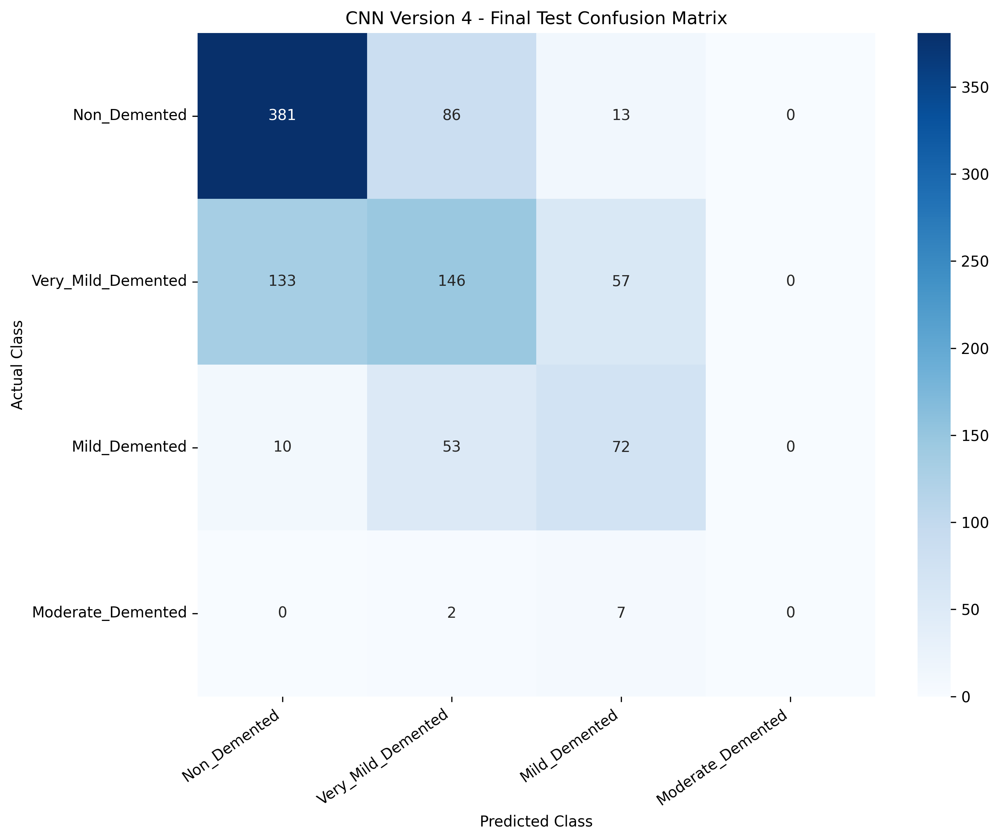

# Alzheimer's Disease Detection and Stage Classification from Brain MRI Images Using Deep Learning

## Project Overview

This final-year B.Tech Computer Science project explores the classification of brain MRI images into four Alzheimer's-related dataset categories using deep learning.

A custom Convolutional Neural Network (CNN) was developed, improved through multiple experiments, and integrated into a Streamlit web application.

**Important:** This is an academic research prototype, not a clinically validated diagnostic system.

## Dataset

Source: [Alzheimer MRI Preprocessed Dataset (Mendeley Data)](https://data.mendeley.com/datasets/3r8hw8wmmk/1)

The dataset contains 6,400 grayscale MRI images of size 128 x 128 pixels.

| Category | Images |
|---|---:|
| Non_Demented | 3,200 |
| Very_Mild_Demented | 2,240 |
| Mild_Demented | 896 |
| Moderate_Demented | 64 |
| **Total** | **6,400** |

The dataset was split into training (70%), validation (15%), and testing (15%) sets using stratified image-level splitting.

Patient identifiers were unavailable, so patient-independent separation could not be verified.

## Methodology

1. Load and preprocess grayscale MRI images.
2. Normalize pixel intensities to the range [0, 1].
3. Create stratified training, validation, and test sets.
4. Develop and compare custom CNN architectures.
5. Apply augmentation and class imbalance handling.
6. Evaluate the selected model on the held-out test set.
7. Integrate the trained model with Streamlit.

## CNN Experiments

| Model | Validation Accuracy | Validation Macro F1 |
|---|---:|---:|
| CNN V2 | 53.44% | 0.27 |
| CNN V3 | 60.62% | 0.37 |
| CNN V4 | 64.69% | 0.46 |

CNN V4 was selected using the best validation-loss checkpoint.

CNN V4 uses convolutional layers, batch normalization, max pooling, dense layers, dropout, and training-image augmentation.

Partial oversampling was used to address class imbalance in the training data.

## Final Test Results

The selected CNN V4 model was evaluated on 960 held-out test images.

| Metric | Result |
|---|---:|
| Test accuracy | 62.40% |
| Test loss | 0.7367 |
| Macro precision | 0.43 |
| Macro recall | 0.44 |
| Macro F1-score | 0.43 |
| Weighted F1-score | 0.61 |

### Test Classification Results

| Category | Precision | Recall | F1-score |
|---|---:|---:|---:|
| Non_Demented | 0.73 | 0.79 | 0.76 |
| Very_Mild_Demented | 0.51 | 0.43 | 0.47 |
| Mild_Demented | 0.48 | 0.53 | 0.51 |
| Moderate_Demented | 0.00 | 0.00 | 0.00 |

The model did not correctly identify any of the nine Moderate_Demented images in the test set.

### Confusion Matrix

## Streamlit Application

A Streamlit interface was developed to demonstrate MRI image classification.

Features include:

- Uploading JPG, JPEG, or PNG images.
- Grayscale conversion and resizing to 128 x 128 pixels.
- Prediction using the saved CNN V4 model.
- Displaying the predicted dataset category.
- Visualizing probabilities across all four categories.

The application passed a single-image functional integration test.

The Streamlit source code is maintained separately in the project files. Public deployment requires portable model paths and appropriate security settings.

## Technologies Used

- Python
- TensorFlow and Keras
- NumPy and Pandas
- Scikit-learn
- Matplotlib and Seaborn
- Streamlit
- Google Colab
- Google Drive

## Repository Contents

- `Alzheimers_MRI_Classification.ipynb` - CNN experiments and evaluation.
- `cnn_experiment_comparison.csv` - Experiment comparison.
- `results/` - Saved evaluation outputs.
- `README.md` - Project documentation.

## Limitations

- Moderate_Demented recall was 0% on the held-out test set.
- The dataset is strongly imbalanced.
- Patient-independent splitting could not be verified.
- Results may be affected by correlations between images.
- Model probabilities are not clinically calibrated.
- The system has not undergone external clinical validation.

The model must not be used for medical diagnosis or treatment decisions.

## Future Work

- Compare the custom CNN with transfer learning models such as VGG16 or ResNet50.
- Evaluate using patient-independent datasets.
- Improve performance on underrepresented categories.
- Explore Grad-CAM visual explanations.
- Prepare a portable and securely deployed application.

## Project Status

- Custom CNN training: Completed
- CNN V4 evaluation: Completed
- Streamlit prototype: Completed
- Single-image integration test: Completed
- Transfer learning comparison: Planned
- Clinical validation: Not performed

## Disclaimer

This project is intended for academic research and educational demonstration only.
